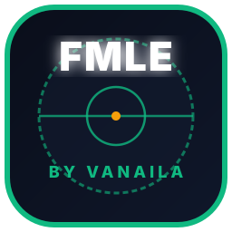
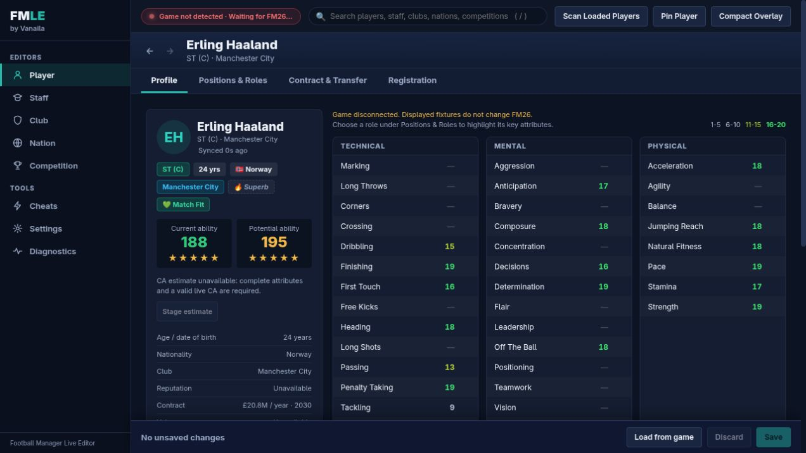
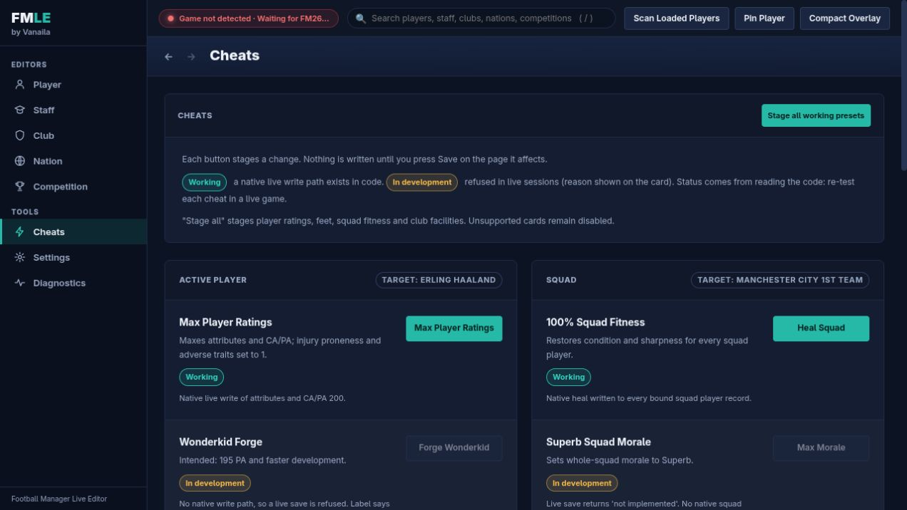

```text
  ███████╗███╗   ███╗██╗     ███████╗    ██████╗ ██╗   ██╗
  ██╔════╝████╗ ████║██║     ██╔════╝    ██╔══██╗╚██╗ ██╔╝
  █████╗  ██╔████╔██║██║     █████╗      ██████╔╝ ╚████╔╝ 
  ██╔══╝  ██║╚██╔╝██║██║     ██╔══╝      ██╔══██╗  ╚██╔╝  
  ██║     ██║ ╚═╝ ██║███████╗███████╗    ██████╔╝   ██║   
  ╚═╝     ╚═╝     ╚═╝╚══════╝╚══════╝    ╚═════╝    ╚═╝   
                                                           
   ██╗   ██╗ █████╗ ███╗   ██╗ █████╗ ██╗██╗      █████╗  
   ██║   ██║██╔══██╗████╗  ██║██╔══██╗██║██║     ██╔══██╗ 
   ██║   ██║███████║██╔██╗ ██║███████║██║██║     ███████║ 
   ╚██╗ ██╔╝██╔══██║██║╚██╗██║██╔══██║██║██║     ██╔══██║ 
    ╚████╔╝ ██║  ██║██║ ╚████║██║  ██║██║███████╗██║  ██║ 
     ╚═══╝  ╚═╝  ╚═╝╚═╝  ╚═══╝╚═╝  ╚═╝╚═╝╚══════╝╚═╝  ╚═╝ 
```

<div align="center">

# FMLE by Vanaila

**Real-Time Memory Editor, Scouting Suite & Tactical Toolkit for Football Manager 26**

[](https://github.com/coderaulia/fmlev/releases/latest)
[](https://github.com/coderaulia/fmlev)
[](https://github.com/coderaulia/fmlev)
[](https://unity.com)
[](https://github.com/coderaulia/fmlev)

### 🇮🇩 *Made with love from Jakarta for the Indonesian & Global Football Manager community!*

*An open-source, high-performance real-time memory editor, scouting suite, and in-game toolkit for **Football Manager 26** running on Linux (via Steam Proton / Wine) and Windows.*

</div>

---

## 📸 Overview & Live Dashboard

<p align="center">
  
</p>

The editor uses an FM26-style sidebar, entity header, compact attribute tables and one
Load/Review/Save/Discard bar. Search includes players, staff, clubs, nations and competitions.
Nothing is saved by changing a field. Native actions and presets are staged for explicit Save;
unavailable controls explain why they are disabled.

**Demo screenshots** — captured from the rebuilt editor while FM26 was closed. These show
layout and interaction, not live-game write or save/reload proof.





- **Player:** profile, attributes, positions/roles, contract and read-only Registration Doctor sub-tabs.
- **Staff:** Head Coach, Coaching, Scouting and Medical views. Attribute editing requires experimental opt-in.
- **Club:** information, facilities and native balance/transfer-budget controls under the shared save bar.
- **Nation:** youth rating, reputation, economic factor and raw development code. Population is read-only.
- **Competition:** reputation, raw-GBP prize-table matching and staged registration actions. Match/squad rule editors remain unavailable.
- **Compact overlay:** horizontally scrollable navigation, stacked cards, larger control targets and wrapped save actions.

Keyboard: `/` focuses search, Ctrl/Cmd+S saves the active editor, Up/Down moves between
attribute cells, Enter keeps an attribute edit and Escape restores its value at focus.
See [UI architecture](docs/UI_ARCHITECTURE.md) and [completed UI plan](docs/UI_PLAN.md).

---

Live player writes support positions, foot ratings, all 60 exposed attributes
(technical, mental, physical, goalkeeper and hidden/personality), CA/PA,
and validated weekly wages (GBP) and contract expiry years. The engine features
**screen-independent native entity discovery**: any player or club in the database
(including opposition players, scouted players, and free agents) can be selected,
inspected, and edited live without needing to open their profile on screen in FM26.
You can also use **Scan Loaded Players** to bulk-index native records for instant
global search (indexing ~49,500 players in ~1 second).
Other entity saves return an explicit unsupported error until their native layouts
are verified. See [live verification and limitations](LIVE_READ_WRITE.md).

## 📦 Downloads & Distribution

Get started in seconds! Run the 1-click launcher or install a desktop icon to launch FMLE without ever typing a terminal command.

| Platform / Edition | Package Format | Direct Launcher | Quick Start |
| :--- | :--- | :--- | :--- |
| **Linux (Steam Proton / Wine)** | 1-Click Desktop Icon | `start.sh --desktop` | Double-click **FMLE by Vanaila** on Desktop |
| **Linux (Terminal)** | Bash Shell Script | `./start.sh` | Auto-detects FM26 process & opens browser |
| **Windows 10 / 11** | Batch Script | `start.bat` | Double-click `start.bat` |
| **Binary CLI** | Native Rust Executable | `cargo run -p fmlev-cli` | `cargo run -p fmlev-cli -- serve` |

---

## 🌟 What is FMLE by Vanaila?

**FMLE by Vanaila** is the premier open-source live editor engineered specifically for **Football Manager 26's new Unity 6 engine**. 

FM26 made history by transitioning away from Sports Interactive's legacy proprietary C++ engine to Unity 6 (64-bit IL2CPP). `FMLE` reverse-engineers the IL2CPP metadata v31 runtime, extracting runtime symbol tables, data references, and UI singletons to give you unrestricted control over your save game.

### Native capabilities and verification limits

The table distinguishes native API capabilities from the guarded web editor. Unverified transfer actions are disabled in the UI; staff writes require explicit experimental opt-in. UI verification does not replace in-game day-tick and save/reload evidence. Native writes use identity validation, readback and rollback.

| Area | What you can do live | Notes |
| --- | --- | --- |
| **Players** | 60 attributes, positions and feet, CA/PA, weekly wage, contract expiry, condition/sharpness heal | Screen-independent discovery for any player (user & opposition); no need to open profile on screen |
| **Contract extension** | Extend expiry by 1–10 years (`POST /api/player/contract/extend`) | Same date, later year; loaned-out players extend the parent contract; shows after the next day |
| **Contract termination** | API implemented; UI unavailable (`POST /api/player/contract/terminate`) | Multi-object detachment: compacts squad vectors, nulls `0x1e8` contract and `0x130`/`0x138` team pointers **UNVERIFIED in game; see AGENTS.md Phase 11** |
| **Free agent signing** | API implemented; UI unavailable (`POST /api/transfer/sign`) | Formats aligned 200-byte `FULL_CONTRACT` object, sets RTTI/wage/expiry/team pointers, and appends to target squad **UNVERIFIED in game; see AGENTS.md Phase 11** |
| **Loan recall** | API implemented; UI unavailable (`POST /api/player/loan/terminate`) | Compacts loan squad vector, returns team to parent club, clears `+0x1f0` loan node **UNVERIFIED in game; see AGENTS.md Phase 11** |
| **Player transfers** | API implemented; UI unavailable (`POST /api/transfer/move`) | Compacts source squad vector, appends to destination team (verifying spare capacity), updates team pointers **UNVERIFIED in game; see AGENTS.md Phase 11** |
| **Pending transfer acceleration** | API implemented; UI unavailable (`POST /api/transfer/accelerate`) | Updates scheduled join dates in future contract and transfer queue, or switches contract immediately **UNVERIFIED in game; see AGENTS.md Phase 11** |
| **Display settings** | Currency, measurement (metric/imperial) and wage period (weekly/monthly/yearly) in the Settings tab (`GET/POST /api/settings`) | Display only, never writes game memory. Fixed approximate rate table (dated 2026-10-26), no live rates. Club wage budget / max wage stay raw (period unverified) |
| **Role presets** | Raise a player to a role at Level 1/2/3 (`POST /api/player/role-preset` previews, Positions tab stages, normal Save writes) | Only raises values. **Role lists unverified against FM26's role screens; CA increase is an estimate; the owner considers further testing unnecessary.** Level 3 Deep-Lying Playmaker proven to persist through a day tick and save/reload on one player (scout ranges only); Levels 1-2 and exact values not yet checked |
| **Registration doctor** | Read-only check of registration gates for a competition (`POST /api/player/eligibility`, Player → Registration) with a copyable support report | Only the registration window is judged blocked/ok; squad size, home-grown, work permit, non-EU quota, continental registration and appearance limits are reported as unknown. Read live on La Liga only: the closed gate and the squad cap of 25 match the game screen; the home-grown quota is not shown by the game and stays unconfirmed |
| **Staff (read-only)** | Search any staff member and read 22 attributes (coaching, mental, knowledge, scouting, medical) in the Staff tab (`POST /api/staff/search`, `POST /api/staff/native`) | Values match the screen for seven staff profiles (Rust and C++ readers agree). Search shows each member's club and also matches club names; "Open in game" opens the profile on screen. Information tab: year of birth verified; Contract tab: wage and expiry verified (three profiles); reputation, CA/PA, job and role unavailable. Editing (`POST /api/staff/update`) is **experimental** (opt-in checkbox, 501 without `experimental: true`): transactional with readback/rollback; one native field (Tactical) proven in game after a day tick and save/reload; the owner reports staff edits worked in game since (no values recorded) |
| **Squad numbers** | Set a number (1–99 or none); a teammate wearing it is swapped | Shows in game after the next day |
| **Tactical familiarity** | Max for one player or the whole squad | Same change as the game's own action |
| **Club money & facilities** | Balance, transfer budget, training/youth/coaching/recruitment/data analysis/corporate facilities, sugar daddy status, reputations, stadium capacity | User & opposition clubs supported; reopen Club > Finances / Facilities; saved natively via `NativeClubRecord` |
| **Nation macro & youth** | Youth rating (1–200), international reputation (1–10,000), economic factor, raw development code | Population writes are unconfirmed and disabled; changes require Save |
| **Competition reputation** | Native league reputation (1–200 scale) | Saved natively via `NativeCompetitionRecord` |
| **Competition stage rules** | Dynamic registration squad cap (`POST /api/competition/stage-rules`) | Queries and edits active simulation engine `stage_rule_entry` (`+0x98`/`+0xd6`) |
| **Competition prize money** | Edit the per-position prize table | Match first/last prize on Rules; payout source at season end unconfirmed |
| **Register anytime** | Allow squad registration outside the window per competition | Toggles manager flag bit `0x100`, manager squad-number bit `0x200`, and domestic stage gate byte `0x9a=1` |
| **Raw memory tools** | `POST /api/mem/read`, `/api/mem/write`, `/api/mem/scan*`, `/api/actions/heal` | Developer tools. Writes take 1-4096 bytes inside one writable mapping and are transactional (readback, rollback); `POST /api/actions/finances` is disabled (501, use `POST /api/club/money`). `POST /api/attach` rejects malformed bodies. Prefer the entity routes |
| **Search index** | Search every loaded player, staff member, club, nation and competition without opening a screen first (`GET /api/search`, `/api/search/status`, `POST /api/search/rebuild`) | Built in the background by RTTI enumeration; accent-insensitive, ranked and paged. Checked on a live save: counts, build time (1.85 s) and six sampled entities match `fmscan` |
| **Reads** | Club, nation and competition overviews, FIFA ranking, reputation text | Screen-independent discovery via native records |

**Remaining frontiers & limits**:
1. **Creating loans from scratch**: Loan recall has native API code but remains unavailable in the UI pending persistence evidence. Establishing a brand-new loan agreement between two clubs from scratch requires instantiating the game's complex `LOAN_CONTRACT` object graph with multi-party clauses.
2. **In-match simulation rules**: Dynamic stage registration caps are writable, but matchday in-play rules (substitutions count, bench slots, VAR toggles) reside in static competition rule blueprints.
3. **Unmapped club & nation fields**: Club board patience and fan confidence remain unmapped. Nation tax rate, corruption index, languages, and FIFA world ranking points are unmapped.

> ⚠️ **Never edit a player's injury vector.** An emptied vector for an injured player crashes FM26 on the next day and the damage is saved into the career.
> Always test on a throwaway save, and Save As a new file after live edits.

The server only accepts requests from `localhost` / `127.0.0.1` pages (foreign `Origin`/`Host` headers are rejected), because the service includes routes that write game memory.

**Diagnostics:** `tools/fmscan` is a read-only C++ memory scanner for differential investigation and screen-independent native entity discovery. `entity PID club|nation|competition --name TEXT --editor --json` reads guarded facilities, finance, grounds, gender-specific nation youth/reputation and competition reputation/stage-gate data. `fmwrite` is a standalone journaled CLI writer for test-save plan/apply/restore experiments. See [exact native field coverage and remaining WIP](docs/NATIVE_ENTITY_READS.md) and [scanner usage](tools/fmscan/README.md).

### Editing boundaries

The UI never fills unread fields with plausible game data. Unsupported player release clauses,
squad status/happiness, club board metrics, nation governance and matchday competition rules
remain disabled while connected. Role attribute lists and CA estimates are labeled unverified.
Prize edits affect the displayed table; authoritative season-end payouts remain unconfirmed.

The read-only scanner and experimental native APIs expose more than the web editor. Refer to
[LIVE_READ_WRITE.md](LIVE_READ_WRITE.md) before treating an API implementation as game-verified.

---

## 🚀 1-Click Automated Quick Start (For Daily Users)

No need to open a terminal every time you play! You can create a native desktop icon just like a regular game or application.

### 🐧 Linux (Steam Proton / Steam Deck / Native Distros)

#### Step 1: Create Desktop Shortcut (Run Once)
Open your terminal in the `fmlev` folder and run:
```bash
./start.sh --desktop
```
This automatically:
- Creates an application menu launcher at `~/.local/share/applications/fmle-vanaila.desktop`.
- Creates a double-clickable Desktop shortcut at `~/Desktop/fmle-vanaila.desktop`.
- Configures icon and permissions.

#### Step 2: Daily Use (No Commands Needed!)
1. Launch **Football Manager 26** in Steam.
2. Double-click the **FMLE by Vanaila** icon on your Desktop (or open it from your Application Menu / Steam Deck desktop mode).
3. FMLE builds the current code, keeps its terminal open, and opens your browser at `http://localhost:41789`. Ctrl+C stops the server.
4. Edit your players, club, nation, or competitions on the fly!

Server controls (Linux):

```bash
./start.sh                  # Rebuild, then start; a server on an old build is replaced, a current one is reused
./start.sh status           # PID, binary build time, and whether it is outdated
./start.sh restart          # Build first, then replace the server on port 41789
./start.sh stop             # Stop the server, including older launcher instances
./start.sh restart --background  # Optional detached mode with a persistent log
```

Normal starts keep the server in the terminal, including when reusing an existing
server. Ctrl+C or closing that terminal stops the server. Restart rebuilds the code and
opens the browser only after the replacement is ready. If the build fails, the
existing server stays running. Background output goes to
`${XDG_STATE_HOME:-~/.local/state}/fmlev/server.log`; use `stop` from any terminal
to terminate it. An unrelated application on the port is never terminated.

> **💡 Note on Linux Yama Ptrace Permissions**:
> Modern Linux distributions protect processes with Yama LSM. If FMLE indicates that memory access is restricted, run:
> ```bash
> sudo sysctl -w kernel.yama.ptrace_scope=0
> ```
>
> `./start.sh` offers to do this for you on an interactive terminal (sudo asks for your password). To skip the question:
> `FMLE_FIX_PTRACE=yes ./start.sh` sets it for this boot, `FMLE_FIX_PTRACE=persist ./start.sh` also keeps it after reboot
> (`/etc/sysctl.d/99-fmle-ptrace.conf`), `FMLE_FIX_PTRACE=no ./start.sh` never asks. Scope 0 lets any process of your user read
> your other processes' memory; undo with `sudo sysctl -w kernel.yama.ptrace_scope=1` and remove that file.

---

### 🪟 Windows (10 / 11)

1. Launch **Football Manager 26**.
2. Double-click `start.bat`.
3. Your browser will automatically open to `http://localhost:41789`.

---

## 📖 Manual Developer Setup

If you are developing or customizing FMLE:

```bash
# 1. Clone the repository
git clone https://github.com/coderaulia/fmlev.git
cd fmlev

# 2. Verify Rust and assembled UI
cargo check --workspace --all-targets --examples
cargo test --workspace
node --test crates/fmlev-server/tests/*.test.cjs

# 3. Start live editor RPC server on custom port
cargo run -p fmlev-cli -- serve --port 41789
```

Open `http://localhost:41789` in any web browser.

---

## ⌨️ CLI Command Reference

`fmlev` provides a high-performance command-line interface for diagnostics and automation:

```bash
# Check running FM26 process, Proton Wine-prefix, and Linux Yama capabilities
cargo run -p fmlev-cli -- status

# Inspect local FM26 IL2CPP metadata v31 structures
cargo run -p fmlev-cli -- inspect-meta

# Start the embedded live editor daemon
cargo run -p fmlev-cli -- serve --port 41789

# Run tests across all crates (fmlev-core, fmlev-server, fmlev-mem, fmlev-il2cpp, fmlev-overlay)
cargo test --workspace
```

---

## 📁 Repository Structure

```
fmlev/
├── Cargo.toml                  # Workspace manifest
├── start.sh                    # 1-Click launcher & desktop shortcut installer
├── start.bat                   # Windows 1-Click launcher
├── assets/                     # Application icons (icon.svg, icon.png)
├── offsets/
│   └── v26.0.0.json            # Patch-resilient IL2CPP offset mappings
├── crates/
│   ├── fmlev-mem/              # Zero-copy Linux memory driver (process_vm_readv/writev)
│   ├── fmlev-il2cpp/           # IL2CPP types, singleton reader, metadata parser
│   ├── fmlev-core/             # Domain models (Player, Club, Nation, Competition)
│   ├── fmlev-server/           # Embedded Axum REST/WebSocket server + embedded UI
│   ├── fmlev-overlay/          # Browser app-window launcher & Terminal HUD controller
│   └── fmlev-cli/              # CLI executable (fmlev status, fmlev serve)
├── output_dump/                # Decompiled C# structures (dump.cs, script.json)
└── tools/                      # IL2CPP Dumper extraction utilities
```

---

## 🤝 Open Source & Community Contribution

**FMLE by Vanaila** is an **open-source project built for the global football gaming community, with special love for the Indonesian FM & tech ecosystem 🇮🇩**.

Contributions are warmly welcomed:
- 💡 **Report Issues & Bugs**: Help test memory bindings on Steam Deck, Proton Experimental, and Windows.
- 🎯 **Submit Offsets**: Help maintain `offsets/v*.json` for new FM26 patch cycles.
- 💻 **Submit Pull Requests**: Add new tactical macros, scouting views, or UI translations.

To get in touch or collaborate, connect via GitHub or email [care@vanaila.com](mailto:care@vanaila.com).

---

## 📜 License & Credits

- Built with ❤️ using Rust, Axum and plain HTML/CSS/JavaScript.
- Reverse-engineering research assisted by Il2CppDumper.
- Distributed under the MIT License.

<div align="center">

**[⭐ Star this project on GitHub](https://github.com/coderaulia/fmlev)** • **Made with ❤️ from Jakarta for the Indonesian & Global FM Community! 🇮🇩**

</div>

## Using the editor inside the game (Steam overlay)

No extra tooling is needed if FM26 is launched through Steam with the in-game overlay enabled:

1. Start the server and attach: `./target/release/fmlev-cli serve --port 41789`, then attach to the running game.
2. In the game press **Shift+Tab** to open the Steam overlay.
3. Open the overlay **Web Browser** and go to `http://127.0.0.1:41789` (add `?mode=overlay` for the compact layout). Bookmark it in the overlay browser.
4. Use the editor, then press Shift+Tab again to return to the game.

Requirements: Steam Settings > In Game > "Enable the Steam Overlay while in-game" (also for non-Steam games if launched that way). If the overlay does not appear under Proton, check the game's launch options and that the Steam overlay works for other games. See `docs/OVERLAY_PLAN.md` for custom-hotkey options.

